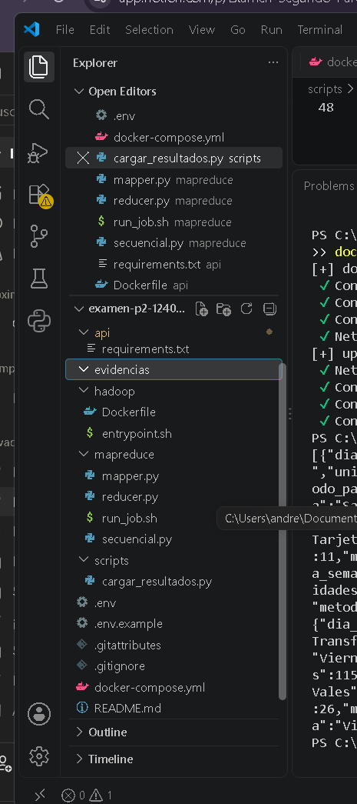

# Examen Segundo Parcial: Pipeline de datos contenerizado

**Materia:** Manejo Masivo de Datos (Big Data)
**Matrícula:** 124050194
**Pregunta asignada (último dígito 4):** unidades vendidas por **método de pago y día de la semana**.

## Arquitectura

Tres servicios en una red de Docker Compose (`pipeline`):


| Servicio | Imagen | Función |
|---|---|---|
| `hadoop` | Debian + OpenJDK 11 + Hadoop 3.3.6 (standalone) + OpenSSH | Procesa el CSV con Hadoop Streaming |
| `db` | PostgreSQL 16 | Guarda los resultados (volumen nombrado `pgdata`) |
| `api` | Python 3.12 + Flask | Expone los resultados y un CRUD |

## Cómo reproducirlo

1. **Generar el dataset** (fuera del repositorio):
   ```
   python generar_dataset.py 124050194
   ```
   Crea `ventas_124050194.csv` (~350 MB, 5 millones de registros). El CSV no se sube al repo.
2. **Configurar variables:** copiar `.env.example` a `.env`, poner una contraseña y ajustar `DATASET_DIR` a la carpeta donde está el CSV.
3. **Levantar el ambiente:**
   ```
   docker compose up -d --build
   ```
4. **Correr el job de MapReduce:**
   ```
   docker compose exec -u hduser hadoop bash /app/mapreduce/run_job.sh
   ```
5. **Cargar los resultados a la base de datos:**
   ```
   docker compose exec api python /scripts/cargar_resultados.py
   ```
6. **Consultar la API:** `http://localhost:5000/resultados`

## Evidencias

| Parte | Evidencia |
|---|---|
| A1 Hadoop |  |
| B SSH sin contraseña (`ssh localhost`) | [ver evidencia](evidencias/02-ssh-localhost.txt) |
| B SSH de `api` a `hadoop` | [ver evidencia](evidencias/03-ssh-api-hadoop.txt) |
| C1 Salida del job | [ver evidencia](evidencias/04-salida-job.txt) |
| C2 Comparativa de resultados | [ver evidencia](evidencias/05-comparativa.txt) |
| D Respuesta de la API | [ver evidencia](evidencias/06-api-resultados.txt) |
| D Persistencia tras `down` y `up` | [ver evidencia](evidencias/07-persistencia.txt) |
| D Endpoint de escritura | [ver evidencia](evidencias/08-api-escritura.txt) |

## Endpoints de la API

| Método | Ruta | Descripción |
|---|---|---|
| GET | `/resultados` | Todos los registros |
| GET | `/resultados/<metodo_pago>` | Filtra por método de pago (opcional `?dia=Lunes`) |
| POST | `/resultados` | Crea un registro |
| PUT | `/resultados/<id>` | Actualiza las unidades |
| DELETE | `/resultados/<id>` | Elimina un registro |

## Comparativa de rendimiento

| Método | Tiempo real |
|---|---|
| Hadoop Streaming (standalone) | 21.241 s |
| Script secuencial en Python | 11.426 s |

Los resultados de ambos son idénticos (verificado con `diff`).

El script secuencial tardó 11.426 s y el job de Hadoop Streaming 21.241 s. En este escenario el secuencial fue más rápido porque el archivo (~350 MB) cabe cómodamente en una sola máquina y el problema se resuelve con un único recorrido y 28 contadores en memoria. Hadoop paga costos fijos: arrancar la JVM, planificar las tareas, lanzar un proceso Python por cada map y, sobre todo, escribir y ordenar los datos intermedios en disco (Spilled Records = 10,000,000). En modo standalone además no hay varios nodos que repartan el trabajo. MapReduce conviene cuando los datos superan lo que una sola máquina puede procesar o almacenar y existe un clúster con HDFS que reparta el cómputo.

## Seguridad

- El CSV y el archivo `.env` están en `.gitignore`; el repo solo incluye `.env.example`.
- SSH solo acepta llaves (sin contraseñas); las llaves se generan al arrancar el contenedor, no en la imagen.
## Parte E. Teoría

**1. Modos de Hadoop.** En *standalone* todo corre en un solo proceso Java, sin demonios, leyendo del sistema de archivos local; es el modo que usa este proyecto. En *pseudo-distribuido* corren todos los demonios (NameNode, DataNode, ResourceManager, NodeManager) en una sola máquina, cada uno en su propio proceso, simulando un clúster. En *totalmente distribuido* los demonios se reparten en varios nodos físicos y los datos se replican entre ellos. HDFS se usa en el pseudo-distribuido y en el totalmente distribuido; en standalone no.

**2. Dataset como volumen y no con `COPY`.** (a) La imagen no engorda ~350 MB y se construye mucho más rápido. (b) Los datos viven fuera de la imagen: se pueden cambiar o regenerar sin reconstruirla. (c) El CSV no queda dentro de la imagen ni del repositorio, así que no se sube a GitHub ni a un registro de imágenes. (d) Se monta en solo lectura (`:ro`), por lo que el contenedor no puede modificar el original.

**3. `docker compose down` vs `down -v`.** `docker compose down` elimina los contenedores y la red, pero los volúmenes nombrados se conservan; por eso los datos de PostgreSQL (`pgdata`) siguen ahí al volver a hacer `up`. `docker compose down -v` elimina también los volúmenes, así que la base de datos se pierde y hay que volver a cargar los resultados.

**4. MapReduce vs script secuencial.** Con un archivo de ~350–400 MB, Hadoop paga costos fijos (arrancar la JVM, planificar tareas, lanzar procesos Python, escribir y ordenar datos intermedios en disco) y en standalone no hay varios nodos que repartan el trabajo; por eso mi script secuencial (11.426 s) le ganó a Hadoop (21.241 s). MapReduce conviene cuando los datos son demasiado grandes para una sola máquina (cientos de GB o más), cuando hay un clúster con HDFS que reparta el cómputo y cuando el proceso es paralelizable.

**5. `CMD` vs `ENTRYPOINT`, `COPY` vs `ADD`.** `CMD` define el comando por defecto del contenedor y se reemplaza fácilmente con lo que se escribe después de `docker run imagen`. `ENTRYPOINT` define el ejecutable fijo del contenedor; lo que se escribe después se agrega como argumentos (solo se reemplaza con `--entrypoint`). `COPY` solo copia archivos o carpetas del contexto a la imagen. `ADD` hace lo mismo pero además descomprime archivos `.tar` locales y acepta URLs; por eso se recomienda `COPY` salvo que se necesite esa función extra.
